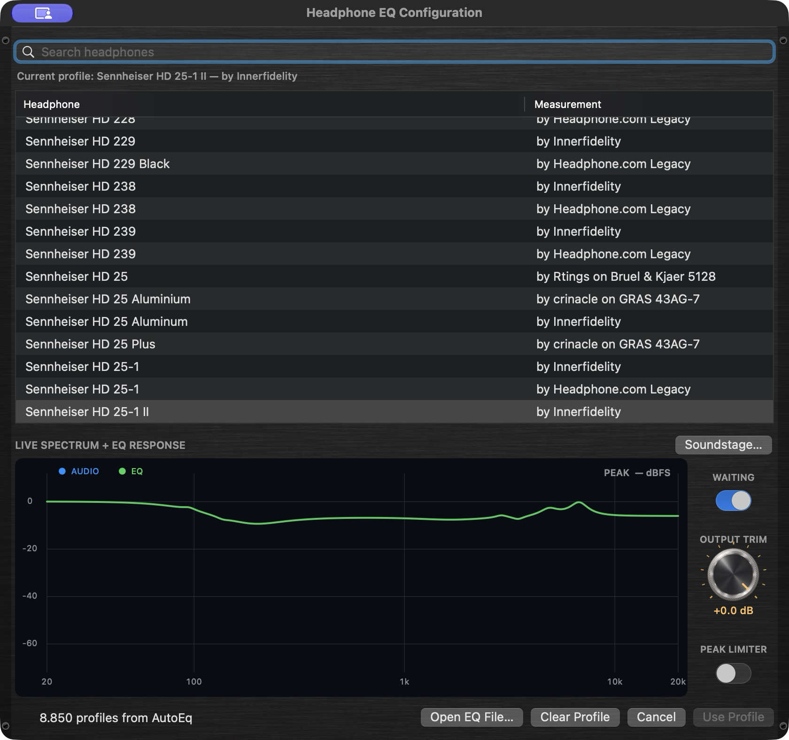

# Headphone EQ

A tiny, native macOS menu-bar equalizer for system audio. Headphone EQ loads
standard Equalizer APO parametric profiles without requiring a virtual audio
driver, a DAW, or a permanent background service.



## How it works

The app creates a private Core Audio process tap for the current output device,
mutes the original stream while the tap is being read, moves stereo samples
through a small lock-free ring buffer, processes them with macOS's native audio
equalizer, and plays the result through the selected output.

Audio processing happens entirely locally. The optional AutoEq catalog in the
configuration window downloads the public profile index and selected preset
from GitHub; no audio, device information, analytics, or telemetry is
transmitted. No third-party audio plug-ins are loaded. The optional soundstage uses bundled,
Apache-2.0-licensed SADIE II measurements.

## Download

Pre-built, Developer ID-signed, and Apple-notarized versions are published on
the [GitHub Releases](https://github.com/mjhagen/headphone-lab-menu/releases)
page. Unzip the archive and move **Headphone EQ.app** to `/Applications`.

## Requirements

- macOS 14.2 or newer
- A stereo output device
- An internet connection when browsing AutoEq profiles or checking for updates

The first time processing starts, macOS requests **System Audio Recording**
permission. This allows the Core Audio tap to receive playback; it does not use
the microphone.

## Automatic headphone detection

Processing runs only when headphones are the selected macOS audio output. Switching
back to speakers, a display, AirPlay, or an unidentified output stops the audio tap
and bypasses both EQ and soundstage. The menu shows **Waiting for Headphones**;
processing resumes automatically when you select headphones again. Turning the
configuration window's **Enabled** switch off prevents automatic resume, including
after restarting the app. Your profile, trim, limiter, and soundstage settings stay saved.

Detection uses the selected output's headphone terminal, active audio source, and
recognizable headphone names, including AirPods. Bluetooth connectivity alone does
not identify headphones. For a USB DAC or another output that does not identify itself,
select **Use as Headphone Output** in the menu bar. That choice is remembered
for the output and its selected source; uncheck it to return to automatic detection.
The app follows macOS's default playback output; applications that explicitly select
another device are outside that route. A DAC cannot report whether its analog cable
feeds headphones or speakers, so update that choice if you change what is attached.

## Binaural soundstage

Choose **Binaural Soundstage…** from the menu bar or **Soundstage…** from the configuration window to hear stereo
through two virtual loudspeakers. Select among three measured SADIE II ear
profiles, adjust speaker angle and distance, and shape room width, depth, height,
treatment, and room presence. Live stereo audio drives an animated energy-flow
view through the current room geometry. Sparse direct arrivals retire past the
listener; dimmer reflections fade using the renderer’s frequency-dependent room
decay. The virtual speakers use a generic enclosed-cabinet model aimed at the
listener: bass wraps broadly around the boxes, while higher frequencies favor
the front. Audio reflections and the display share that radiation model. Full view shows
faint thin bass wrap with stronger forward mid/treble arcs; band views make each
radiation pattern easier to inspect.
Actual processed ear waveforms and
three seconds of output-level history react to the music and settle in silence.
Choose full-band or frequency-specific input activity; display controls leave
audio playback unchanged.
The studio-style panel uses machined rotary dials and illuminated readouts: drag
up or down, scroll, or use the arrow keys. Hold Shift for fine adjustments;
double-click a dial to restore its default. **Optimal Placement**, below the
speaker dials, stays lit while it automatically fits an equilateral stereo triangle
to the room as dimensions change, with cabinet clearance and both speakers aimed
at the listener. The mode persists across restarts. Adjust angle or distance to
return to manual placement.

The custom renderer combines directional early reflections with subtle late
reverberation. Settings persist and crossfade live, before headphone EQ and the
limiter. It is off by default and processes entirely locally. Use headphones and
switch it off for recordings already rendered in binaural audio.

The renderer reserves 6 dB of headroom and adds 128 frames of buffering latency
(2.67 ms at 48 kHz), including soundstage bypass; enabled rendering also models
sound travel time. It virtualizes stereo speakers rather than recovering a
recording's original 3D scene. Head tracking and personal SOFA import are not
included. See [renderer details and data attribution](docs/soundstage.md).

## Equalizer APO profiles

Choose **Headphone Profile…** and use the search field to browse AutoEq's
public catalog of thousands of headphone measurements. The index is cached
locally for one week; only the selected parametric profile is downloaded and
applied. Duplicate model names remain visible because they may come from
different measurement sources. The configuration window identifies the active
profile and highlights its matching catalog row as soon as it opens. Selecting
another result previews it
immediately on the running audio stream. Choose **Use Profile** to save it, or
close the window to restore the previously active profile. It overlays the
selected EQ response on a live, 16,384-sample spectrum of the processed audio.
Its peak indicator warns when the signal approaches the digital ceiling. Use
the persistent output-trim knob to attenuate the route by up to 24 dB without
restarting audio; double-click the knob to reset it to 0 dB.

**Peak Limiter** prevents digital sample clipping inside Headphone EQ. It places
Apple's native peak limiter after the headphone EQ with its minimum 1 ms
look-ahead, followed by a -0.3 dB output safety margin. It does not change the
route's buffer size or restart audio, and remains transparent until a peak
reaches the ceiling. Enabling it resets output trim to 0 dB and locks the trim
knob until the limiter is disabled. The setting persists between launches and
is controlled from the configuration window. Like any sample-peak limiter, it
cannot guarantee against inter-sample peaks reconstructed by downstream
hardware, clipping in other applications, or distortion already present in the
source.

The app computes analyzer targets at 15 Hz and Core Animation interpolates the
full-resolution paths at the display's native refresh rate (up to 120 Hz). This
keeps the motion fluid without running a dedicated 120 Hz application render
loop. All analyzer updates and animations stop immediately when the window
closes.

The catalog is provided by the independent, MIT-licensed
[AutoEq project](https://github.com/jaakkopasanen/AutoEq); Headphone EQ is not
affiliated with AutoEq or its measurement contributors.

You can also choose **Open EQ File…** in the configuration window and select a
local UTF-8 text profile. Either kind of profile is copied into the app's
preferences, so the original file does not need to remain available. **Clear
Profile** restores a flat response.

Headphone EQ supports the common AutoEq and Room EQ Wizard parametric subset:

- `Preamp` (multiple values are added);
- peaking filters: `PK`, `PEQ`, and `Modal`;
- center-frequency shelves: `LS`, `LSC`, `HS`, and `HSC`;
- low- and high-pass filters: `LP`, `LPQ`, `HP`, and `HPQ`;
- band-pass (`BP`) and notch (`NO`) filters; and
- filter widths expressed as either `Q` or `BW Oct`.

Profiles may contain up to 32 enabled filters.

For example:

```text
Preamp: -6.4 dB
Filter 1: ON PK Fc 31 Hz Gain 4.2 dB Q 0.50
Filter 2: ON LS Fc 105 Hz Gain 3.0 dB Q 0.71
Filter 3: ON HS Fc 10000 Hz Gain -2.5 dB BW Oct 1.5
```

Disabled filters are ignored. Unsupported commands are rejected with their line
number instead of being silently misapplied. `GraphicEQ`, convolution, channel
matrices, device selection, includes, expressions, third-party plug-ins, and the
`LS/HS 6dB` or `12dB` corner-frequency variants are not supported.

See Equalizer APO's
[configuration reference](https://sourceforge.net/p/equalizerapo/wiki/Configuration%20reference/)
for the source format.

## Build

Install Xcode, then run:

```sh
make app
```

The application is written to `build/Headphone EQ.app`. Launch it with
`make run`, or install it in `/Applications` with `make install`.

Local builds are ad-hoc signed without hardened runtime so their embedded
Sparkle framework can load. Developer ID builds retain hardened runtime. Maintainers can create a hardened-runtime,
Developer ID-signed and notarized archive using a `notarytool` Keychain profile:

```sh
xcrun notarytool store-credentials "headphone-lab-menu"
make notarize VERSION=3.0.0 \
  SIGN_IDENTITY="Developer ID Application: Your Name (TEAMID)"
```

The notarized ZIP and SHA-256 checksum are written to `build/`.

## Updates

Headphone EQ uses the MIT-licensed
[Sparkle](https://sparkle-project.org/) framework. It checks the signed update
feed once per day and also provides **Check for Updates…** in the menu. Updates
are downloaded from this repository's GitHub Releases. The feed, release notes,
and archives are signed with Sparkle's Ed25519 key; archives must also pass
Apple's code-signing checks before they are installed.

Maintainers keep the private Sparkle key in the login Keychain under the
`nl.mingo.HeadphoneLabMenu` account. Create or display that key with:

```sh
make sparkle-key
```

Only the public key in `Resources/Info.plist` is committed. To publish a
release, first bump both bundle versions and then run:

```sh
make release VERSION=3.0.0 \
  SIGN_IDENTITY="Developer ID Application: Your Name (TEAMID)"
```

This signs and notarizes the archive, signs it with the local Sparkle key, and
updates `appcast.xml`. Commit and publish the updated appcast alongside the
release. The key can later be exported with Sparkle's `generate_keys -x` and
stored as a GitHub Actions secret; it must never be committed.

## Usage

Use the headphones icon in the menu bar to open the native macOS menu. The
**Headphone Processing** checkmark controls automatic processing on headphones;
the line below it reports whether audio is being processed or is waiting for headphones.

**Headphone Profile…** shows the selected model and opens the EQ browser.
**Binaural Soundstage…** shows whether virtual speakers are enabled or paused and
opens room settings. **Peak Limiter** toggles clipping protection directly;
**Output Trim…** opens equalizer settings to adjust attenuation. **Audio Output…**
shows the selected device and opens macOS Sound settings. Manual headphone
identification appears only for outputs that need it.

The remaining actions are **Check for Updates…**, **Launch at Login**, and
**Quit Headphone EQ**. The menu uses standard system appearance, SF Symbols,
checkmarks, and, on macOS 14.4 or newer, native subtitles.

The configuration window lets you:

- enable or disable system-wide equalization, with the choice retained across
  launches;
- search and select a measured headphone profile from AutoEq;
- audition AutoEq profiles live before saving one;
- inspect the selected response and post-EQ audio on a live spectrum display;
- reduce output gain manually, or enable Peak Limiter to prevent sample
  clipping inside the app;
- open or clear a local Equalizer APO profile;
- open the binaural soundstage controls; and
- see the active response and output spectrum while making changes.

## Known limitations

- Only stereo system playback is supported.

## Development

```sh
swift test
swift build -c release
```

See [CONTRIBUTING.md](CONTRIBUTING.md) for contribution guidelines and
[SECURITY.md](SECURITY.md) for private vulnerability reporting.

## License

The source code and original project artwork are available under the
[MIT License](LICENSE). Bundled SADIE II measurements are provided under
[Apache-2.0](Sources/HeadphoneLabMenu/Resources/HRTF/LICENSE.txt), with
[University of York attribution](Sources/HeadphoneLabMenu/Resources/HRTF/NOTICE.txt).
